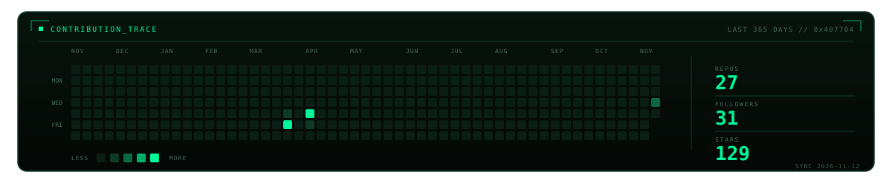

<p align="center">
  
</p>

<p align="left">
  <code>STATUS: ONLINE</code>&nbsp;&nbsp;<code>NODE: 127.0.0.1</code>&nbsp;&nbsp;<code>CLEARANCE: AUTHORIZED</code>
</p>


## 01 // WHOAMI

```console
imran@kali:~$ whoami
Imran Shaikh

imran@kali:~$ cat /etc/role
Penetration Tester · Bug Hunter · Cybersecurity Researcher · YouTuber

imran@kali:~$ cat /etc/focus
Web · API · Android · Network Security · Red Teaming · OSINT

imran@kali:~$ cat /etc/principle
Break. Learn. Report. Repeat.
```

I test web, API, Android and network surfaces. Then I write the finding so it can be fixed, not just filed.


## 02 // ARSENAL

| VECTOR | TOOLKIT |
| :--- | :--- |
| `WEB` | `burpsuite` `sqlmap` `ffuf` `zap` `nikto` |
| `RECON` | `subfinder` `amass` `gau` `waybackurls` `shodan` `maltego` `theHarvester` |
| `NETWORK` | `nmap` `netcat` `wireshark` `aircrack-ng` |
| `EXPLOIT` | `metasploit` `searchsploit` `msfvenom` |
| `SYSTEM` | `kali` `parrot` `ubuntu` `windows` `powershell` |
| `BUILD` | `python` `bash` `javascript` `docker` `aws` `git` |

> All testing is performed against authorized targets only. No exceptions.


## 03 // PAYLOADS

| ID | REPO | STACK | FUNCTION |
| :--- | :--- | :--- | :--- |
| `01` | [HostInjection](https://github.com/imran407704/HostInjection) | `python` | Host header injection and web cache poisoning scanner |
| `02` | [Learn365](https://github.com/imran407704/Learn365) | `research` | Daily cybersecurity learning archive |
| `03` | [passive-subd](https://github.com/imran407704/passive-subd) | `bash` | Passive subdomain enumeration automation |
| `04` | [multi-urls](https://github.com/imran407704/multi-urls) | `bash` | Passive URL harvesting from gau, gauplus and waybackurls |
| `05` | [archive](https://github.com/imran407704/archive) | `bash` | URL aggregation and archival automation |
| `06` | [list-target](https://github.com/imran407704/list-target) | `bash` | Target wordlist generator for bug bounty |
| `07` | [My-eJPT-Journey](https://github.com/imran407704/My-eJPT-Journey) | `notes` | eJPT exam preparation resources |

[ `$` view all repositories → ](https://github.com/imran407704?tab=repositories)


## 04 // CONTRIBUTION TRACE



> Public signal only. Private work stays private.


## 05 // BROADCAST

```console
imran@kali:~$ open https://www.youtube.com/@cybersecops7146
[BROADCAST] labs · tooling · bug bounty
```

[ `[ YouTube ]` @cybersecops7146 ](https://www.youtube.com/@cybersecops7146) — labs, tooling and the hunt, recorded.


## 06 // UPLINKS

| CHANNEL | ENDPOINT |
| :--- | :--- |
| `GITHUB` | [github.com/imran407704](https://github.com/imran407704) |
| `X` | [x.com/imran407704](https://x.com/imran407704) |
| `LINKEDIN` | [linkedin.com/in/imran407704](https://www.linkedin.com/in/imran407704/) |
| `YOUTUBE` | [youtube.com/@cybersecops7146](https://www.youtube.com/@cybersecops7146) |

> "The quieter you become, the more you are able to hear." — Kali Linux


